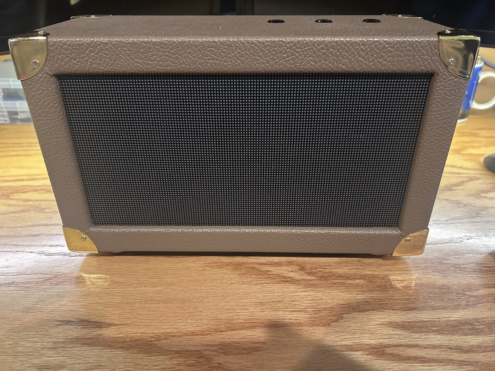
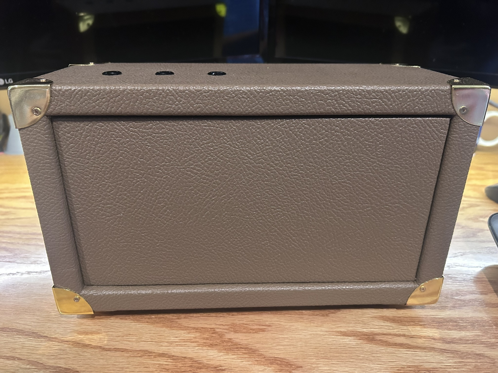

# ESP32-S3 HUB75 Scoreboard

A self-contained, physical two-player LED scoreboard built around an ESP32-S3 and a 128×64 P2 RGB HUB75 matrix. The scoreboard is complete and working; scores are controlled by three illuminated panel-mount buttons, with no phone or network connection required.



## Project status

**Physical build: complete and working.**

The original BLE firmware was uploaded and tested with all five scoring commands, the physical controls, and reconnection. The native iPhone controller was installed on a physical iPhone and verified in both scoring directions. The physical controls continue to work independently.

## Final build

- ESP32-S3 controller
- 128×64 P2 RGB HUB75/HUB75E panel, 1/32 scan
- ICN2038S/Chipone-family panel driver configuration
- LLidgermal ESP32 HUB75 adapter board (ASIN B0FVNMRRTB)
- Three illuminated momentary push buttons
- ADRESUNO 5V 10A / 50W production power supply (ASIN B0D76F4W1C)
- SDTC Tech 5.5×2.5 mm panel-mount DC power connection
- Panel-mount USB-C service/programming extension
- Custom finished enclosure with gold-tone corner protectors and removable rear access panel
- Local controls requiring no Wi-Fi, cloud service, or phone

### Controls

| Control | Short press | Long press (≥600 ms) |
|---|---|---|
| Player One | +1 | −1 |
| Player Two | +1 | −1 |
| Reset | No action | Reset both scores |

Player names are intentionally isolated at the top of the production sketch:

```cpp
const char* PLAYER_ONE_NAME = "PLAYER 1";
const char* PLAYER_TWO_NAME = "PLAYER 2";
```

The rest of the firmware uses generic Player One / Player Two variables so future BLE control can replace the hard-coded names without rewriting the scoring logic.

## Final photos



## Repository layout

```text
.
├── README.md
├── docs/
│   ├── bill-of-materials.md
│   ├── bringup-and-hardware.md
│   ├── hardware.md
│   ├── project-history.md
│   ├── software.md
│   ├── wiring.md
│   └── images/
│       └── final/
└── firmware/
    ├── bringup/
    └── scoreboard/
        └── scoreboard.ino
```

## Firmware

The production sketch is [`firmware/scoreboard/scoreboard.ino`](firmware/scoreboard/scoreboard.ino).

It uses:

- `ESP32-HUB75-MatrixPanel-I2S-DMA`
- Adafruit GFX font `FreeSansBold9pt7b`
- 128×64 display geometry
- ICN2038S driver mode
- Explicit ESP32-S3 HUB75 GPIO mapping
- GPIO 12, 13 and 14 for the three controls
- `INPUT_PULLUP` button inputs
- 600 ms long-press threshold
- Display brightness value of 140/255

See [`docs/software.md`](docs/software.md) for the complete software configuration.

## Hardware and wiring

The final working pin map, power topology, button wiring and physical construction are documented in:

- [`docs/hardware.md`](docs/hardware.md)
- [`docs/wiring.md`](docs/wiring.md)
- [`docs/bill-of-materials.md`](docs/bill-of-materials.md)

## Prototype history

The project originally started with a much denser P1.53 208×104 / 1:52-scan commercial-signage module. Although it used a HUB75-family connector, it was not a straightforward match for the ESP32 direct-drive approach. The final build moved to a conventional 128×64 P2 / 1:32 panel and was successfully driven directly from the ESP32-S3.

That failed path is retained in [`docs/project-history.md`](docs/project-history.md) because it is useful information for anyone trying to reproduce the project.

## BLE firmware and iPhone controller

Use the [BLE sketch](firmware/scoreboard_ble/scoreboard_ble.ino) for wireless control.

- P1 is the lower blue row (GPIO12, default PLAYER 1). P2 is the upper green row (GPIO13, default PLAYER 2).
- Scores are readable/notifiable. Drawing and scoring run in loop(), not BLE callbacks.
- The [native iPhone controller](ios/ScoreboardController/START-HERE.md) has large plus/minus controls, reset confirmation, live scores, and reconnect handling. See the [iOS bring-up history](ios/ScoreboardController/IOS-BRINGUP.md) for the setup and screenshots.
- With the current BLE sketch and iPhone app, **Edit player names** saves both labels on the scoreboard. Names stay saved when the panel loses power. See [player name setup](ios/ScoreboardController/START-HERE.md#edit-player-names-on-the-panel).

**Install on the Mac:** open `ios/ScoreboardController/ScoreboardController.xcodeproj`, choose your signing Team, select your iPhone, and Run. Disconnect nRF Connect before connecting the new app. The controller can score with the earlier BLE firmware. Name editing requires the current BLE sketch.

See [the BLE/nRF Connect guide](docs/BLE-FIRMWARE-AND-NRF-CONNECT.md) for protocol details and [the iPhone setup guide](ios/ScoreboardController/START-HERE.md) for installation.

Additional files:

```text
firmware/scoreboard_ble/             # Tested BLE sketch
firmware/reference/panel_bringup/   # Panel bring-up sketch
ios/ScoreboardController/          # Xcode app + protocol tests
```

## License

No license has been selected yet.
