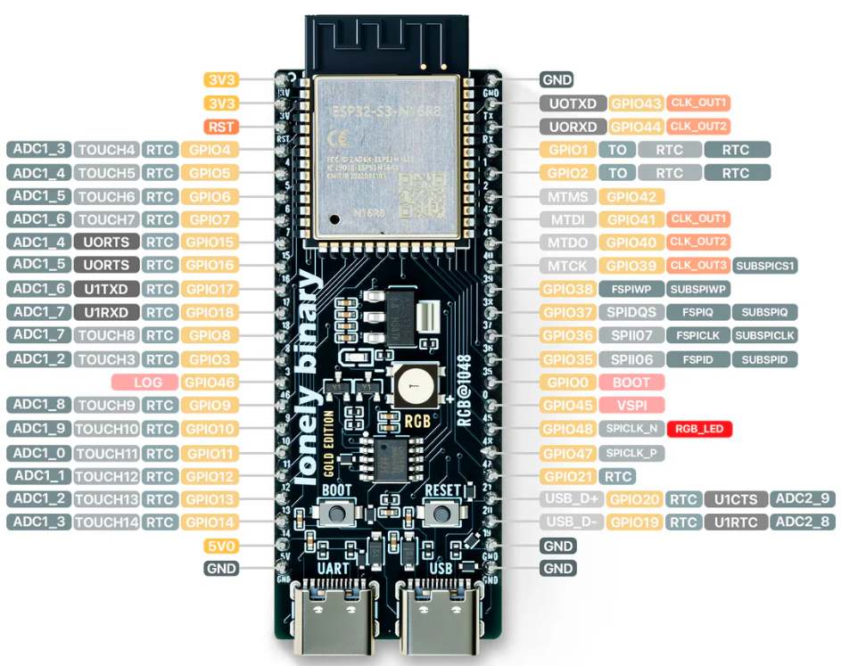

# ESP32 Scoreboard — Bring‑Up & Hardware Docs (Draft)

> **Status:** Draft — will be revised as hardware arrives and tests complete.

This document contains:

1. A **pre-written ESP32 bring‑up sketch** (software-only sanity test)
2. A starter **enclosure design note**
3. A **wiring skeleton with safety warnings**

---

## 1) ESP32 Bring‑Up Sketch (Pre‑Panel)

**Purpose**

* Verify Arduino toolchain
* Verify ESP32-S3 boots and flashes
* Verify Serial output
* Provide a single flag to enable HUB75 later

**Do NOT connect the LED panel yet.**

## Bring-Up Results (Confirmed)

- ESP32-S3 flashed via USB successfully
- Serial output verified at 115200 baud
- Button inputs tested:
  - Short press detected
  - Long press detected
  - All three buttons functional
- Button LED rings powered from 5V rail and operational

### Build Assumptions

* Board: **ESP32-S3 Dev Module / ESP32-S3‑DevKitC‑1**
* Arduino IDE 2.x
* Package: **esp32 by Espressif Systems**

### Bring‑Up Sketch

```cpp
// ============================================================
// ESP32 Scoreboard — Bring‑Up Test
// ============================================================
// Phase 1: ESP32 sanity check (NO LED PANEL CONNECTED)
// Phase 2: Enable HUB75 later by flipping ENABLE_HUB75
// ============================================================

#include <Arduino.h>

// Uncomment ONLY after LED panel arrives and wiring is verified
//#define ENABLE_HUB75

#ifdef ENABLE_HUB75
  #include <ESP32-HUB75-MatrixPanel-DMA.h>
#endif

void setup() {
  Serial.begin(115200);
  delay(500);

  Serial.println("---------------------------------");
  Serial.println("ESP32 Scoreboard Bring‑Up");
  Serial.println("CPU: ESP32‑S3");
  Serial.println("Flash OK");
  Serial.println("PSRAM OK (if present)");
  Serial.println("---------------------------------");

#ifdef ENABLE_HUB75
  Serial.println("HUB75 ENABLED (panel expected)");
#else
  Serial.println("HUB75 DISABLED (ESP32‑only test)");
#endif
}

void loop() {
  static uint32_t last = 0;
  if (millis() - last > 1000) {
    last = millis();
    Serial.println("ESP32 alive...");
  }
}
```

**Expected Result (Phase 1)**

* Sketch compiles
* Upload succeeds
* Serial Monitor prints `ESP32 alive...` every second

Only after this passes do we enable HUB75.

---

## 2) Enclosure Design Notes (Starter)

**Target Depth:** ~2 inches (≈50 mm)

### Why 2 inches works well

* HUB75 ribbon cable bend radius
* ESP32 + adapter board stack height
* Button wiring clearance
* Power cable strain relief

### Recommended Features

* Front recess for LED panel
* Rear removable panel (maintenance access)
* Vent slots (LED panels generate heat)
* Internal standoffs for:

  * HUB75 adapter
  * ESP32 DevKit

### Mounting Notes

* Do NOT hard-mount the LED panel without airflow
* Avoid compressing the ribbon cable
* Plan button spacing for kids’ hands

### Materials

* PLA+ or PETG recommended
* Avoid black PLA if panel runs warm (heat soak)

Final enclosure dimensions were deferred until the LED module
arrived, as vendor specifications do not include connector
protrusions, PCB tolerances, or cable bend requirements.

---

## 3) Wiring Skeleton & Safety Warnings

> **READ BEFORE APPLYING POWER**

### Power Rules (Critical)

* **5V power goes directly to the LED panel**
* **DO NOT power the panel through the ESP32**
* Always share a **common ground**

```
5V PSU (+) ─────────► LED Panel +5V
5V PSU (GND) ───────► LED Panel GND
5V PSU (GND) ───────► ESP32 GND
```

### ESP32 Power

* During development: USB
* Final install: VIN / DC input on adapter board

### Button Wiring (Momentary NO)

Each button:

```
Button pin 1 ───► ESP32 GPIO
Button pin 2 ───► ESP32 GND
```


Software will use **internal pull‑ups**.

### Safety Warnings

* Double‑check 5V polarity **before** powering
* Start with **low brightness** when panel arrives
* Never hot‑plug HUB75 ribbon under power

---

## Next Steps

1. ESP32 arrives → run Bring‑Up Sketch (Phase 1)
2. Verify buttons with GPIO test sketch
3. LED panel arrives → enable HUB75
4. Display solid colors
5. Begin scoreboard logic

---

*This document will be updated as wiring, firmware, and enclosure designs evolve.*
