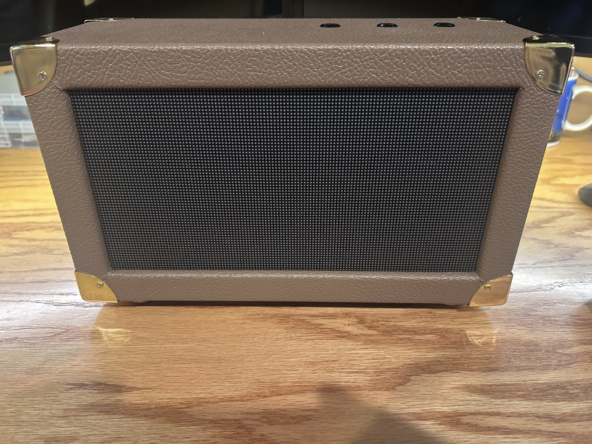
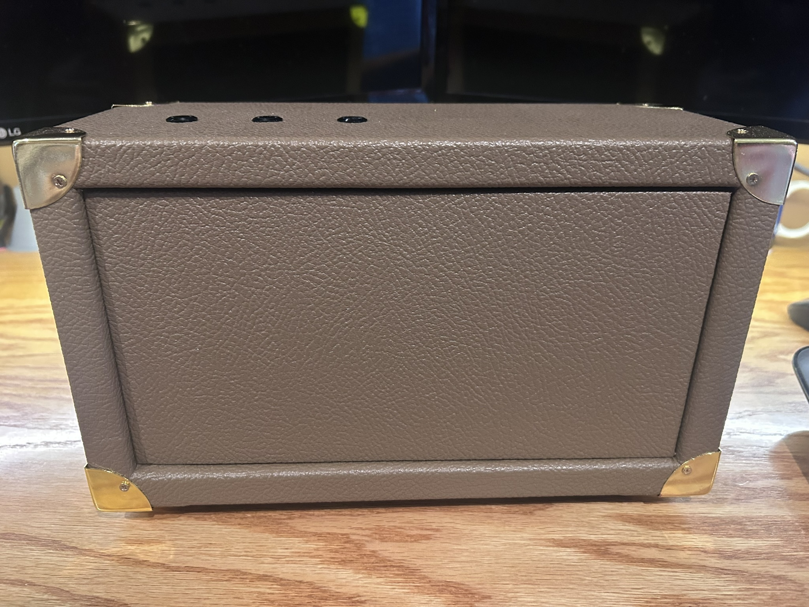

# Hardware

## Final hardware architecture

The completed scoreboard uses a conventional direct-drive HUB75 design:

```text
                     +----------------------+
Physical buttons --->|                      |
                     |      ESP32-S3        |---- HUB75 ----> 128×64 RGB panel
Future iPhone BLE -->|                      |
                     +----------+-----------+
                                |
                               5V / common ground
```

## RGB matrix

The successful final panel is a P2 indoor RGB matrix with the following documented characteristics:

- Physical module size: 256×128 mm
- Resolution: 128×64 pixels
- Pixel pitch: 2 mm
- Scan: 1/32
- HUB75/HUB75E interface
- 5V operation
- SMD1515 LEDs in the listing
- Chipone 2038S-family driver hardware

The production firmware uses the library's `ICN2038S` driver mode.

## Controller

ESP32-S3-DevKitC-1 N16R8:

- ESP32-S3
- 16 MB flash
- 8 MB PSRAM
- Wi-Fi and Bluetooth Low Energy
- USB programming

The board is installed in a **LLidgermal ESP32 LED Matrix Adapter Board with Dual Power Input & HUB75 Interface** ([Amazon ASIN B0FVNMRRTB](https://www.amazon.com/dp/B0FVNMRRTB)). The adapter provides the HUB75 connector and convenient power/signal routing and is listed for ESP32/ESP32-S3 use. The exact working GPIO map is documented in [`wiring.md`](wiring.md) and in the production sketch.

## Controls

The finished enclosure has three illuminated momentary push buttons on the top panel. The design intentionally compresses all scoring into three controls:

- Player One: short +1 / long −1
- Player Two: short +1 / long −1
- Reset: long press

This replaced the earlier concept of separate + and − buttons for each player.

## Enclosure

The final physical build uses a custom box-style enclosure with:

- Front opening fitted to the 256×128 mm matrix
- Finished brown textured exterior
- Gold-tone uxcell decorative metal corner protectors ([Amazon ASIN B0DBG9KCJX](https://www.amazon.com/dp/B0DBG9KCJX))
- Three top-mounted controls
- Side access for power/USB hardware
- Removable rear service panel
- Internal wood structure supporting the display and electronics





## Power and service connections

The production power supply is now positively identified as an **ADRESUNO 5V 10A 50W AC/DC adapter** ([Amazon ASIN B0D76F4W1C](https://www.amazon.com/dp/B0D76F4W1C)). It accepts 100–240V AC and provides regulated 5V DC at up to 10A.

The finished enclosure uses an **SDTC Tech 5.5×2.5 mm, 10A threaded panel-mount DC jack** ([Amazon ASIN B0B6FFN4V5](https://www.amazon.com/dp/B0B6FFN4V5)) to bring the power connection through the case. A **Poyiccot 1-foot USB 3.1 Type-C panel-mount extension** ([Amazon ASIN B086YBP5VW](https://www.amazon.com/dp/B086YBP5VW)) provides external USB-C programming/service access without removing the rear panel.

Power is distributed through the LLidgermal HUB75 adapter to the ESP32-S3/panel system with a common ground. See [`wiring.md`](wiring.md) for the topology and [`bill-of-materials.md`](bill-of-materials.md) for purchase references.
