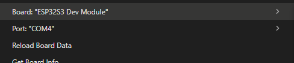
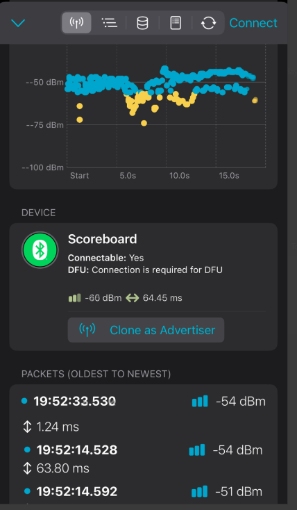
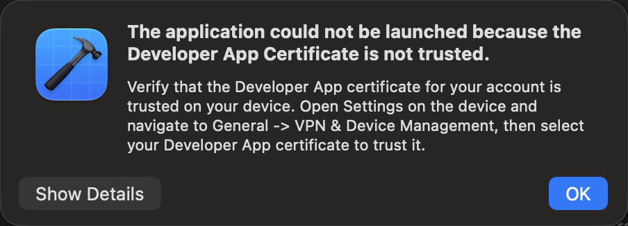

# From the ESP32 upload to live iPhone scores

The ESP32-S3 already drove the panel and handled the three physical buttons. The next milestone was to add wireless control and prove that the physical scoreboard and the phone agreed about the score. The original production sketch and the separate tested BLE sketch are both retained.

## Getting the firmware onto the right port

Select **ESP32S3 Dev Module** in Arduino IDE. Reconnect the board with a data cable and check which serial port appears in **Tools → Port**. Select that port before uploading.

The successful build used Espressif Arduino core 3.3.7. The [BLE firmware guide](../../docs/BLE-FIRMWARE-AND-NRF-CONNECT.md) records the tested libraries, display and button settings, and GATT test procedure.

## Proving Bluetooth before opening Xcode

With the panel powered, nRF Connect on iPhone discovered the connectable **Scoreboard** advertisement. Discovery proved that the phone could see the board. The next test proved that the connection could actually carry scoring commands and state.

1. Connect in nRF Connect and open the custom service beginning with `ea180001`. Read and subscribe to the score state on `ea180003`.
2. Write `P1+`, `P1-`, `P2+`, `P2-`, and `RESET` to `ea180002` using Write with Response. Send exact ASCII without a line ending. P1 is the lower blue row and P2 is the upper green row. Watch the panel and the state notifications together.
3. Press the panel buttons and watch for notifications. Disconnect, reconnect, read the current state, and send another command.
4. Disconnect nRF Connect before using the SwiftUI app.

## Signing, pairing, and launching on the iPhone

Open the repository's `ScoreboardController.xcodeproj` on a Mac in an Xcode version that supports the phone's iOS version. The deployment target is iOS 16. If Xcode reports a missing team, an unavailable bundle identifier, or a missing provisioning profile, add your Apple Account in Xcode Settings, select the app target under **Signing & Capabilities**, keep **Automatically manage signing** enabled, and select your Team. If the identifier is unavailable to that Team, choose one unique to you. Use the same Team for the test target when running tests on a physical device. [Apple's device build and signing guide](https://developer.apple.com/documentation/xcode/running-your-app-on-simulated-or-physical-devices)

Connect the unlocked iPhone using a data cable and accept **Trust This Computer** if prompted. If it is missing or unavailable as a run destination, check pairing in Xcode's device manager and wait for device preparation to finish. Select the **ScoreboardController** scheme and the physical iPhone. [Apple's device pairing guide](https://developer.apple.com/documentation/xcode/pairing-your-devices-with-your-mac)

On the iPhone, open **Settings → Privacy & Security → Developer Mode**, enable it, and restart. Unlock, confirm after the restart, and enter the passcode when prompted. If the switch is missing, start pairing with Xcode first. [Apple's Developer Mode instructions](https://developer.apple.com/documentation/xcode/enabling-developer-mode-on-a-device/)

The remaining launch error was explicit. Xcode reported that the **Developer App Certificate is not trusted**. On the iPhone, open **Settings → General → VPN & Device Management**, choose the Developer App identity for the account used in Xcode, and follow the phone's trust prompts. Back in Xcode, dismiss the error and run again with **⌘R**. Computer pairing, Developer Mode, and Developer App trust are separate steps.

## The bidirectional test

On the phone, allow Bluetooth access, tap **Find scoreboard**, and connect to the board. Wait for **Connected · Live scores**. The app reads the current score and subscribes for updates before enabling its scoring buttons.

Verify that app controls update the scoreboard and that physical buttons update the app. Repeat the reset, reconnect, and foreground checks in [Start Here](START-HERE.md).

## Original plan for panel-synced player names

The original BLE firmware drew fixed names. The follow-up app and BLE firmware implement this plan. See [Edit player names on the panel](START-HERE.md#edit-player-names-on-the-panel) for the installation and device checks.

The original design notes follow. The existing eight-byte score packet and the five scoring commands should stay compatible with older apps and boards.

1. Add a separate versioned read/write/notify names characteristic in the BLE firmware. Detect it in the app so older firmware can continue scoring and the app can explain why panel name editing is unavailable.
2. Define a bounded payload for the two player slots and a character set supported by the panel font. Check rendered pixel width with room for the score on each row. Validate both names before applying either and preserve the last valid pair across reboot using ESP32 nonvolatile storage.
3. Route validated updates through the firmware loop. Redraw the panel and publish the applied names. The app should read names when connecting and show a save as complete after reading or receiving the confirmed pair. Keep P1 mapped to GPIO12 and the lower blue row and P2 mapped to GPIO13 and the upper green row.
4. Test empty, invalid, and over-wide names, interrupted saves, reconnect, power cycles, and old app/firmware combinations. Repeat bidirectional scoring and reset with the new labels.
